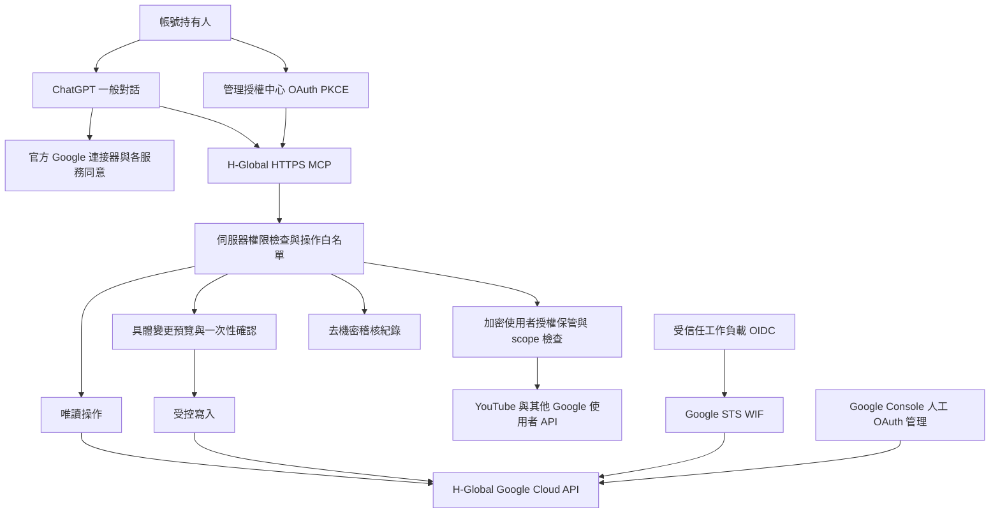

# H-Global Google 管理整合紀錄

日期：2026-10-23（Asia/Taipei）。此文件為進行中紀錄，不是正式驗收證明。

## 已核實環境

- 指定專案 `h-global1985`；Google 管理帳號 `hglobal1985@gmail.com`。
- 原工作目錄是 WordPress public_html，不存放任何 Google 憑證。
- 安裝 Google Cloud SDK 590.0.0，官方 ARM64 安裝包 SHA-256：`b1f80ffe9cc970ff1935b4adfddd0fb89d7e7b3341a88d70216d4283211b8d2d`。
- SDK 在 `~/.local/share/hglobal-management/google-cloud-sdk`；獨立 `CLOUDSDK_CONFIG=~/.config/gcloud-hglobal`、configuration `hglobal`。沒有變更其他 gcloud configuration。
- GitHub 基準 commit：`749d75af7f62fea0a0c8088ef8d786264a716774`。
- Cloudflare 已實際讀取 `hglobal-central-id-v2` settings（HTTP 200）：`CENTRAL_DB`、`LEGACY_AUTH_DB`、`ECHO_TICKETS_ENABLED`；尚無 `HGLOBAL_GOOGLE_CLIENT_ID`。
- Gmail profile 實際回傳另一帳號 `yukidu@gmail.com`，不能當作 H-Global 已連接。本次未讀取郵件內容。
- Google CLI 已成功登入指定帳號；專案、IAM 與已啟用 API 已唯讀盤點，詳見 inventory.json。帳號既有 roles/owner，本次未新增任何 IAM 授權。帳務唯讀查詢回傳 billingEnabled=false；配額仍待查詢。未啟用任何 API、付費帳務或資源。

## OAuth 設定目標與限制

應用名稱：H-Global 中央會員 ID；External；支援與開發者 Email：hglobal1985@gmail.com；授權網域：hglobal1985.com。
Web Client 名稱：H-Global Central ID Web；正式 JavaScript origin：https://id.hglobal1985.com。
新 Client ID（帳號持有人提供）：`791614645185-vbaqqbnr463r1vi4ga41uh73s7eg0gv5.apps.googleusercontent.com`。已設定 Preview；帳號持有人補上 Preview origin 後，已回報成功登入並提供 /dashboard 截圖。正式 origin 與完整 Console 設定尚未逐項核實。

Google 官方 OAuth 最佳實務明確要求 Console 建立及修改一般 OAuth client，不能承諾提供自動建立、修改或刪除這些 client 的公開 API。IAP 或 IAM 同名 OAuth 介面不得當成一般 Google Sign-In client API。

已檢查 `portal-script.mjs`：GIS `ux_mode:popup` 透過 JavaScript callback 接收 ID token，再 POST `/api/v1/portal/google-login`；目前這個流程不需要 OAuth redirect URI。Echo 的 `/auth/callback` 是內部 ticket 交換，不能填成 Google redirect URI。Preview origin 若用於真實登入，需在 Console 明確加入現有 Preview 網域並確認用途。

授權中心將使用另外的管理用途 OAuth client，與會員登入 client 分開。管理 callback 需等實際部署路由及 OAuth 流程完成才登記，不能猜測。

本次自動 HTTP 查詢 `/login`、`/privacy`、`/terms` 與 `/api/v1/compat/readiness` 均回傳 403，無法據此判定頁面不存在或登入已壞；需瀏覽器驗證。政策頁、網域所有權、同意畫面發布狀態及 Google 驗證尚未核實；不建立虛假政策或宣稱驗證完成。需要正式隱私政策、資料保存/刪除方式、服務條款、聯絡資訊與網域驗證證據。敏感／受限 scopes 應逐項判斷審查需求。

## 登入隔離變更

`HGLOBAL_GOOGLE_CLIENT_ID` 僅影響中央 portal challenge 與 JWT 的 `aud`/`azp`。Echo compatibility 的既有 Client ID、cookie、ticket 與 user_id 映射不變。

為避免尚未設定新 Client ID 就破壞現站，未設定 binding 暫時保留舊值；明確設定空字串、null 或錯誤格式則拒絕登入。正式切換驗收必須確認 binding 為新 ID，不能把 fallback 當作完成隔離。

25 項本機 Node 測試與 iOS 資料分隔測試通過。GitHub PR #31 的程式 commit `bc3cac35032cbb1c098e589bbb26313e35ff5f7d` 已通過全部 7 個回報檢查，含 typecheck、語法、公開頁面測試及 CodeQL（修改程式無新增警示）。測試 RSA 金鑰及 token 都是單元測試 fixture，不能作為真實 Google 登入證據。正式驗收還需新帳號登入、既有會員 user_id 穩定、Echo 舊登入可用、跨 audience 拒絕、nonce 重放拒絕、登出與撤銷生效。

## Google API 決策清單

以下是候選用途，不是已啟用清單；實際啟用前檢查現有服務、IAM 與費用。

| API/能力 | 判斷 |
|---|---|
| serviceusage.googleapis.com | 盤點服務；核准後才啟用特定 API |
| cloudresourcemanager.googleapis.com | 指定專案與 IAM 讀取 |
| iam.googleapis.com | 專用身分/WIF 設定，修改屬需確認操作 |
| iamcredentials.googleapis.com | 選用 SA impersonation 才需要 |
| sts.googleapis.com | 採用 WIF 才需要 |
| Google Auth Platform 一般 client 管理 API | 沒有本任務可採用的受支援公開管理 API；Console |
| Cloud Audit Logs | 稽核能力，不是假想的 OAuth 管理 API；Data Access 日誌須評估費用與設定 |
| logging.googleapis.com / monitoring.googleapis.com / cloudquotas.googleapis.com | 選定查詢實作、權限與配額種類後評估 |
| secretmanager.googleapis.com | 目前不啟用；依最終機密保管環境再決定 |
| youtube.googleapis.com | 頻道功能與個別 OAuth consent 就緒後評估 |
| drive / gmail / calendar / sheets / analyticsdata / searchconsole | 官方連接器可滿足時優先使用；自訂功能才啟用相應 API |

## 長期架構（設計，尚未部署）

不得讓 MCP 接收任意 URL、shell 指令或任意 project_id。伺服器固定 `h-global1985`，每個 tool 對應限定方法、資源及 scope；確認必須綁定操作者、規範化參數摘要、期限與一次性 nonce，不能接受模型自行傳 `approved:true`。公開發布、寄信、分享、刪除、IAM 與帳務變更需獨立確認與紀錄。

Cloud IAM 與使用者 Google 資料授權分開：WIF 不會自動授權 Gmail 或 YouTube。Cloudflare Worker 不能被假設天然有 Google 可接受的 workload OIDC；選擇實際受支援的 issuer、audience、subject 條件並實測後才能宣稱無金鑰。GitHub Actions OIDC 僅用於受保護的部署工作，不能拿 CI token 當常駐 Worker 身分。若採 Google 託管執行環境，先確認費用、runtime identity 與部署範圍。

會員 GIS ID token 只證明身分，不授予 Google API 管理權。使用者服務使用增量 scope 與官方離線授權；access token 短效、refresh token 加密存放並支援失效後重新同意。不得把「短效 access token」誤稱完全沒有長效憑證。

## 授權、輪替與撤銷 SOP

1. 先驗證管理者 Google subject 與已驗證 Email，僅允許指定管理者。檢查 Google grant scopes 與 Cloud IAM，不以 email 字串單獨取代驗證。
2. 每新增功能僅申請所需 scopes；列出 API、資源、讀寫風險、保留期間與 Google 審查要求。
3. 初期只提供已驗證的唯讀工具；專用 SA/自訂角色需提供精確 permissions、專案範圍、期限及撤銷方法，經確認後建立。禁止 Owner/Organization Admin。
4. Client secret 存平台機密儲存；refresh token 使用 AEAD 加密，AAD 綁定 principal、provider、scope/grant；金鑰版本化、輪替時重加密。API 回應與日誌不含憑證。
5. 稽核紀錄包含 request id、操作者、tool、目標資源、去機密參數摘要、核准 id、結果、時間與 provider request id。稽核故障時高風險寫入拒絕執行。
6. 撤銷：先禁用管理 principal/session，再撤銷 Google 使用者 grant、刪除加密 token，移除對應 WIF binding 或專用 SA 授權；核對 Cloud Audit Logs。不要停用其他專案或 Starry client。
7. 測試 refresh 失效、scope 被撤銷、帳號錯配與跨專案請求，確保拒絕且要求重新授權。重新授權不恢復未核准權限。

## ChatGPT 一般對話整合矩陣

「有工具」只代表本次 Codex 提供工具；不代表一般 ChatGPT 的該帳號、方案或工作區已連接。

| 服務 | H-Global 已連接 | 可讀取 | 可寫入 | 額外授權 | Google 驗證 | 平台限制 | 一般對話實測 |
|---|---|---|---|---|---|---|---|
| Cloud | CLI 已連接，ChatGPT 未連接 | CLI 專案/IAM/API 已實測 | 白名單待實作 | IAM/管理身分 | 依 OAuth 模式 | 自訂 MCP 需安裝與允許 | 未完成 |
| Auth Platform | 未確認 | Console | Console | 專案權限 | 應用審查待核實 | 無受支援一般 client 管理 API | 未完成 |
| YouTube | 否 | 頻道/影片 API | 上傳/metadata/播放清單/縮圖待實作 | 使用者 OAuth | 依 scope 與上傳政策 | 大檔上傳管線與頻道資格 | 未完成 |
| Drive | 未確認 | 本次有連接工具 | 本次有連接工具 | 指定帳號 consent | 自訂 app 依 scope | 檔案格式/大小及分享確認 | 未完成 |
| Gmail | 否，連到其他帳號 | 本次有工具 | 草稿/寄送等有工具 | H-Global consent | 自訂 app 依敏感/受限 scope | 寄送須明確確認 | 未完成 |
| Calendar | 未確認 | 本次有工具 | 活動管理有工具 | 指定帳號 consent | 自訂 app 依 scope | 邀請對外通知需確認 | 未完成 |
| Sheets | 未確認 | Drive 插件提供工具 | Drive 插件提供工具 | 指定檔案/帳號 consent | 自訂 app 依 scope | 範圍與檔案權限 | 未完成 |
| Analytics | 否 | Data API 待實作 | 本需求僅查詢 | property 權限與 scope | 依 app/scope | property 配額 | 未完成 |
| Search Console | 否 | Search Analytics 待實作 | 網站資源管理待實作 | 網站權限與 scope | 依 app/scope | API 不代表網域所有權已驗證 | 未完成 |

一般 ChatGPT 驗收：由帳號持有人在官方介面新增 MCP/安裝 plugin 並完成 OAuth；開新一般對話，選取該 plugin，實際呼叫固定 H-Global project 查詢及指定使用者服務的最小唯讀操作。保存 tool、參數、request id、非機密結果、時間與確認行為；再驗證拒絕跨專案、refresh 與撤銷。Codex、MCP Inspector 或 API Playground 成功不能取代一般對話驗收。

## YouTube 上傳設計與待驗證

先用使用者授權查詢可用頻道並確認 channel id；不可從 Email 推定所有品牌頻道管理權。最初只申請 `youtube.readonly`，上傳需要 `youtube.upload`，其他管理方法逐項核對所需 scope。

採 resumable upload；不要把大型影片 base64 放入 MCP JSON。將已授權的檔案傳輸機制與上傳 session 分離，限制大小、MIME、目標 host、有效期限與檔案雜湊；禁止任意 URL 抓取。實際發布前列出 channel id、檔案摘要、標題、描述、標籤、公開狀態與訂閱通知選擇，取得明確確認。影片 private 也不能被當成已獲准上傳。

2026-10-23 取得的 videos.insert 官方頁標示上限 256GB，Video Uploads quota bucket 每日 100 次、每次 1 unit；實際專案配額與頻道限制尚未查證，不能保證可上傳。Google OAuth 驗證與 YouTube API 合規稽核分別檢查；未經確認不可宣稱可公開發布。縮圖另受 API、檔案與頻道資格限制。

## 尚未完成與上線門檻

- Google CLI 登入與 IAM/API 盤點已完成；配額完整盤點待完成。
- 新 Google OAuth client 與政策／網域驗證。
- 管理介面實作、部署、專用身分核准、機密儲存與稽核持久化。
- Preview 新 client 真實登入已由帳號持有人驗證；登出／重新登入及 Echo 回歸仍待驗證。
- PR CI、安全檢查、合併、Production 切換與實測。
- H-Global 官方使用者服務連接、一般 ChatGPT 的 Cloud + 使用者服務兩項端到端驗收。

新增功能沿用相同的工具白名單、scope/permission 檢查、確認紀錄、去機密稽核及撤銷機制；先加負向測試與驗收案例，再逐步開放，不能另建不相容登入系統。

## 官方依據

- https://docs.cloud.google.com/sdk/docs/install-sdk
- https://developers.google.com/identity/protocols/oauth2/resources/best-practices
- https://developers.google.com/identity/protocols/oauth2/web-server
- https://docs.cloud.google.com/iam/docs/workload-identity-federation
- https://developers.openai.com/plugins/build/auth
- https://developers.openai.com/plugins/deploy/connect-chatgpt
- https://developers.google.com/youtube/data/reference/rest/v3/videos/insert
- https://developers.google.com/youtube/data/guides/authentication

## 本輪執行限制

進一步唯讀 testIamPermissions 與配額 API 查詢未執行：自動核准審查因使用額度限制無法完成。這不是判定查詢不安全；需待審查恢復再重試，不改用其他工具繞過審查。已完成的 IAM policy 讀取仍有效，但不能聲稱逐項有效權限測試完成。

目前可開啟 Console 分頁，但工具沒有讀取或操作該已登入分頁的能力。需要帳號持有人完成官方 Console 的 OAuth client 設定並提供公開 Client ID，不能把開啟頁面當作設定完成。

## Preview 新 Client ID 部署紀錄

2026-10-23：Cloudflare 上傳成功（HTTP 200），deployment_id `81ffdcc3110143a6993b71f993b9e44b`。部署目標僅 `hglobal-central-id-v2-preview`，程式為 PR #31 的隔離版本；設定回讀確認 HGLOBAL_GOOGLE_CLIENT_ID 等於帳號持有人提供的新 ID。保留 Preview 的 CENTRAL_DB、LEGACY_AUTH_DB 與 ECHO_TICKETS_ENABLED 設定。唯讀 schema 查詢確認 portal 所需資料表已存在，rows_written=0，未執行遷移。

自動 HTTP 檢查 `/login`、`/api/v1/portal/challenge`、`/api/v1/compat/readiness` 仍均為 403，原因未確認，不能當作真實登入成功。下一步由帳號持有人開啟 https://hglobal-central-id-v2-preview.yukidu.workers.dev/login 測試並回報畫面。Production 未部署，PR 未合併，Starry client 未修改。

## 2026-10-24 驗收更新

帳號持有人先遇到 Google `400 origin_mismatch`，新增 Preview JavaScript origin 後回報「可以登入」，並提供 Preview `/dashboard` 截圖。截圖顯示登入者會員控制台與訪客／未核准狀態；記為人工真實登入通過，不公開截圖中的姓名或 user_id。此證據不等同登出撤銷、既有會員映射穩定或 Echo 回歸均通過。

本輪重新讀取正式 Worker 設定成功：仍未設定 HGLOBAL_GOOGLE_CLIENT_ID；CENTRAL_DB 與 LEGACY_AUTH_DB 是不同資料庫。沒有執行正式部署或更動資料庫。PR #31 仍為 Draft。正式切換前需完成 Preview 登出後重新整理 dashboard 會要求登入、再次登入成功，以及原 Echo Google 登入正常之驗收。

## 正式切換前人工驗收

2026-10-24：帳號持有人明確回報「登出、重新登入與原本 Echo 登入都正常」。因此 Preview 真實 Google 登入、登出／重新登入與原本 Echo 登入回歸記為人工驗收通過。尚未證明 Production 新 Client ID 登入成功，也未宣稱一般 ChatGPT 管理連接完成。正式切換僅限中央 portal OAuth client，保留 Starry/Echo audience 與既有資料庫 bindings。
